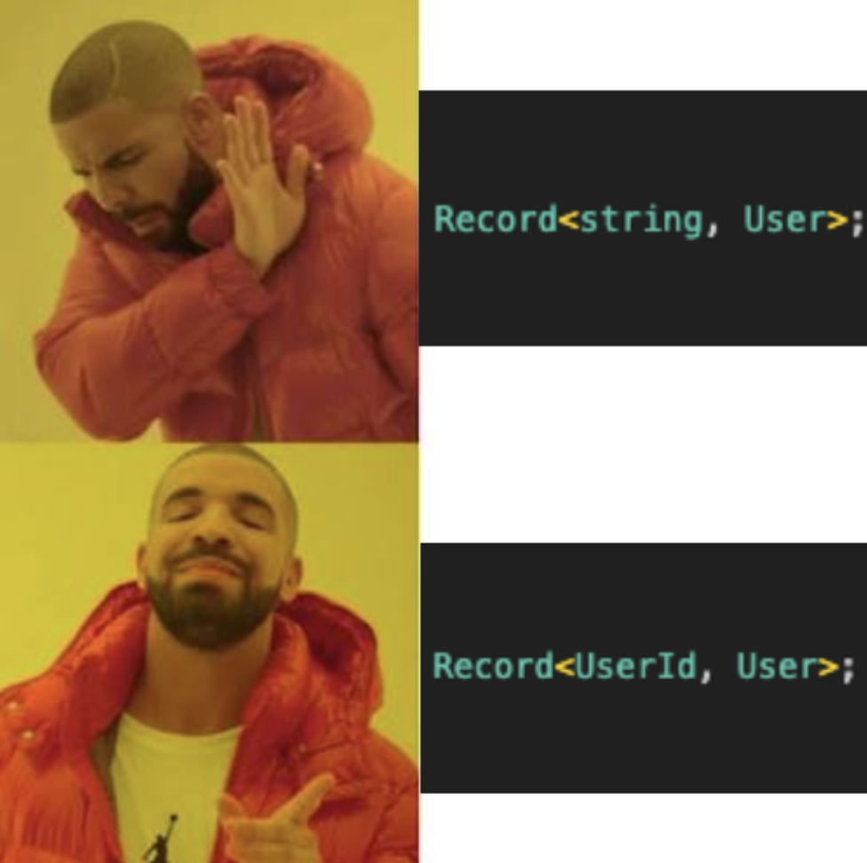

# TypeScript utenfor komfortsonen

<!--  -->

<div class="absolute bottom-10 left-10 text-left">
  <div class="text-lg">Tjøl Ravndal</div>
  <div class="text-md opacity-75">Bekk</div>
</div>

---

# Er TypeScript relevant i 2025?

<div class="grid grid-cols-2 gap-8 top-30px">
  <div>
  <ul>
    <li>113 887 804 Weekly Downloads (npmjs.com, 29.01.26)</li>
    <li>Mest brukte språk på Github i 2025</li>
    <li>JetBrains Tools & Trends 2025: "Among the most dramatic rises in real-world usage over the last five years is TypeScript."</li>
    </ul>
  </div>
  <div>
    
  </div>
</div>

---

<div>
  <h2>
  Vi skal gå gjennom små og store eksempler, og jeg håper at alle kan ta med seg minst en ny teknikk tilbake til oppdrag 🚀
  </h2>
</div>

<style>
div {
  display: grid;
  place-items:center
}
</style>

---

# Template literals i TypeScript

```typescript {1-4|5-10|12-16|12-21|23-27}{maxHeight:'380px'}
// JavaScript Template Literals
const color = "red";
const size = "medium";
const className = `${color}-${size}`; // "red-medium"

// Template literal types i TypeScript
type Color = "red" | "green" | "blue";
type Size = "small" | "medium" | "large";
type ColoredSize = `${Color}-${Size}`;
// Result: 'red-small' | 'red-medium' | 'red-large' | ...

// Eksempel 1: Event Handler Types
type Action = "click" | "hover" | "focus" | "blur" | "change";
type EventHandler = `on${Capitalize<Action>}`;
// Result: "onClick" | "onHover" | "onFocus" | "onBlur" | "onChange"

function handleEvent(event: EventHandler) {
  // Type-safe event handling
}
handleEvent("onClick"); // ✅
handleEvent("click"); // 🚫

// Eksempel 2: CSS Class Variants
type Variant = "primary" | "secondary";
type Size = "sm" | "md" | "lg";
type ButtonClass = `btn-${Variant}-${Size}`;
// Result: "btn-primary-sm" | "btn-primary-md" | "btn-secondary-lg" | ...
```

---

# Branded Types

```typescript {1-2|1-7|9-12|9-14|9-17|9-21|9-24}{maxHeight:'380px'}
const getJournal = async (patientId: string, journalId: string) =>
  await fetch(`api/patient/${patientId}/journal/${journalId}`);

const patientId = "12345";
const journalId = "67890";

await getJournal(journalId, patientId); // Feil rekkefølge!

// Løsning: Branded Types
declare const __brand: unique symbol;
type Brand<T, B> = T & { [__brand]: B };

type PatientId = Brand<string, "PatientId">;
type JournalId = Brand<string, "JournalId">;

const getJournal = async (patientId: PatientId, journalId: JournalId) =>
  await fetch(`api/patient/${patientId}/journal/${journalId}`);

const patientId = "12345" as PatientId;
const journalId = "67890" as JournalId;

// Type error: Argument of type 'JournalId' is not assignable to parameter of type 'PatientId'
await getJournal(journalId, patientId); // 🚫 Type error!
```

---

<div class="flex justify-center items-center">
  
</div>

---

# Typeof & Keyof

```typescript {1-4|1-13|15-23|15-30|31-46|31-56|54-63}{maxHeight:'400px'}
const minKonto = {
  saldo: 100,
  eier: "Ola Normann",
};

type KontoInferred = typeof minKonto;

/*
type KontoInferred = {
  saldo: number;
  eier: string;
}
*/

interface KontoSkjema {
  id: string;
  eier: {
    fornavn: string;
    etternavn: string;
  };
  saldo: number;
  transaksjoner: unknown[];
}

type SkjemaFelter = keyof KontoSkjema;

/*
type SkjemaFelter = "id" | "eier" | "saldo" | "transaksjoner"
*/

export const DebounceConstants = {
  createNewRow: {
    none: 0,
    veryShort: 200,
    short: 1000,
    medium: 5000,
    long: 15000,
  },
  cellEdited: {
    short: 300,
    medium: 750,
    long: 1200,
    maxWait: 30000,
  },
} as const;

export type CreateNewRowDebounceTime =
  keyof typeof DebounceConstants.createNewRow;

/*
type CreateNewRowDebounceTime = "none" | "veryShort" | "short" | "medium" | "long"
*/

function debounceNewRow(delay: CreateNewRowDebounceTime) {
  const timeout = DebounceConstants.createNewRow[delay];
  return timeout;
}

debounceNewRow("short"); // ✅
debounceNewRow("nonexistent"); // 🚫 Type error!
```

---

# Bruk Extends for å stille krav til generics

```typescript {1-3|1-17|1-23}{maxHeight:'410px'}
interface ListProps<T extends { id: number }> {
  items: T[];
  renderItem: (item: T) => React.ReactNode;
}

function List<T extends { id: number }>({ items, renderItem }: ListProps<T>) {
  return (
    <>
      {items.map(item => (
        <div key={item.id}>  {/* TypeScript knows 'id' exists */}
          {renderItem(item)}
        </div>
      ))}
    </>
  );
}

// ✅ Works
<List items={[{ id: 1, name: "Alice" }]} renderItem={item => item.name} />

// ❌ Compile error - missing 'id'
<List items={[{ name: "Alice" }]} renderItem={item => item.name} />
```

---

# Const assertion

```typescript {1-2|1-8|10-15|10-19|21-35|37-55}{maxHeight:'400px'}
const list = [1, 2, 3];
// TypeScript inferer typen av list til number[]

list.push(4);
/* 
Siden lista kan endres så er typen fleksibel til å tillate flere tall.
Dette er en liste med tall, og TS vet ikke hvor mange eller hvilke verdier.
*/

const list2 = [1, 2, 3] as const;
/* 
TypeScript inferer typen av list2 til readonly [1, 2, 3]

Dette er en liste med tall, og TS vet at det kun er disse tre tallene.
*/

list2.push(4); // 🚫 Error: Property 'push' does not exist on type 'readonly [1, 2, 3]'.

// Ved å bruke 'as const' så vet vi at lista er endelig, og TypeScript kan derfor gi en mer spesifikk type.

// Eksempel
// Uten 'as const'
const MENU_ITEMS = [
  { label: "Hjem", path: "/" },
  { label: "Profil", path: "/profil" },
  { label: "Innstillinger", path: "/innstillinger" },
];

type MenuItem = (typeof MENU_ITEMS)[number];
/* 
type MenuItem = {
    label: string;
    path: string;
}
*/

// Med 'as const'
const MENU_ITEMS_CONST = [
  { label: "Hjem", path: "/" },
  { label: "Profil", path: "/profil" },
  { label: "Innstillinger", path: "/innstillinger" },
] as const;

type MenuItemConst = (typeof MENU_ITEMS_CONST)[number];
/* 
type MenuItem = {
    readonly label: "Hjem";
    readonly path: "/";
} | {
    readonly label: "Profil";
    readonly path: "/profil";
} | {
    readonly label: "Innstillinger";
    readonly path: "/innstillinger";
}*/
```

---

# Satisfies operator

```typescript {1-9|11-24|26-39}{maxHeight:'420px'}
const routes: Record<string, `/${string}`> = {
  hjem: "/",
  profil: "/users/:id",
  dashboard: "/dashboard",
};
/*  
Record<string, `/${string}`>
Ulempe: typen blir bred, og vi mister informasjon om at det kun er strenger som starter med "/" 😕
*/

const routesWithoutTypes = {
  hjem: "/",
  profil: "/users/:id",
  dashboard: "/dashboard",
} as const;

/* 
{
    hjem: "/";
    profil: "/users/:id";
    dashboard: "/dashboard";
}
Bedre, men ikke optimalt 🤔 Vi har mistet kravet om at routes må starte med "/"
*/

const routesSatisfies = {
  hjem: "/",
  profil: "/users/:id",
  dashboard: "/dashboard",
} satisfies Record<string, `/${string}`>;

/* 
{
    hjem: "/";
    profil: "/users/:id";
    dashboard: "/dashboard";
}
Med satisfies har vi bevart type-sikkerhet og informasjon om at det kun er strenger som starter med "/" 🤩
*/
```

---

# Bruk 'never' for å sørge for at alle valg er dekket i en switch-case

```typescript {maxHeight:'400px'}
type Color = "red" | "green" | "blue" | "yellow";

const getColorHex = (color: Color): string => {
  switch (color) {
    case "red":
      return "#FF0000";
    case "green":
      return "#00FF00";
    case "blue":
      return "#0000FF";
    default:
      const _exhaustiveCheck: never = color;
      // 🚫 Type '"yellow"' is not assignable to type 'never'.ts(2322)
      return _exhaustiveCheck;
  }
};
```

<!--
adw
-->

---

# 'Never' for å filtrere ut uønskede typer

```typescript {1-4|1-12|1-22|10-36|22-44|46-51}{maxHeight:'420px'}
// Felles base
type BaseColumn = {
  id: string;
  label: string;
};

// Når kolonnen er redigerbar
type EditableColumn = BaseColumn & {
  isEditable: true;
  placeholder: string;
  onEdit: (value: string) => void;
};

// Når kolonnen IKKE er redigerbar
type NonEditableColumn = BaseColumn & {
  isEditable?: false | undefined;
  placeholder?: never;
  onEdit?: never;
};

// Kombinert variant
type Column = EditableColumn | NonEditableColumn;

const nameCol: Column = {
  id: "name",
  label: "Navn",
  isEditable: true,
  placeholder: "Skriv inn navn",
  onEdit: (v) => console.log(v),
};

const idCol: Column = {
  id: "id",
  label: "Bruker-ID",
  isEditable: false,
};

const badCol: Column = {
  id: "email",
  label: "E-post",
  isEditable: false,
  placeholder: "Ikke lov her", // ❌ Type '"Ikke lov her"' is not assignable to type 'never'
  onEdit: () => {}, // ❌ Type '() => void' is not assignable to type 'undefined'
};

// Enda bedre versjon av NonEditableColumn 😍
type BetterNonEditableColumn = BaseColumn & {
  isEditable: false;
} & {
  [key in keyof Pick<EditableColumn, "placeholder" | "onEdit">]?: never;
};
```

---

# Infer for å ekstrahere typer

```typescript {1-15|16-40}{maxHeight:'400px'}
// Hent ut item type i en liste
const persons = [
  { name: "Ola Nordmann", age: 34 },
  { name: "Kari Hansen", age: 51 },
];

type ArrayItemType<T> = T extends Array<infer E> ? E : never;

type Person = ArrayItemType<typeof persons>;
/*
type Person = {
  name: string;
  age: number;
};
*/

// Fra React sin typedefinisjon
// @types/react/index.d.ts

type ContextType<C extends Context<any>> =
  C extends Context<infer T> ? T : never;

function createContext<T>(defaultValue: T): Context<T>;

const MyContext = createContext({ foo: "bar" });

type MyContextType = ContextType<typeof MyContext>;

/*
type MyContextType = { foo: string }
*/
```

---

# Lagre en type i variabel for gjenbruk

```typescript {1-21|23-30|23-44|44-70}{maxHeight:'420px'}
import { CSSProperties } from "react";

type BaseTheme = {
  color: {
    primary: string;
    secondary: string;
    accent: string;
    background: string;
  };
  font: {
    family: string;
    size: number;
  };
  spacing: {
    xs: number;
    sm: number;
    md: number;
    lg: number;
    xl: number;
  };
};

const createThemedStyle = <TTheme extends BaseTheme>() => {
  const useStyle = (fn: (theme: TTheme) => CSSProperties) => {
    // Mock implementation
    return {} as CSSProperties;
  };

  return { useStyle };
};

// Lagre Theme i variabelen useStyle
const { useStyle } = createThemedStyle<BaseTheme>();

const containerStyle = useStyle((theme) => ({
  backgroundColor: theme.color.background,
  padding: theme.spacing.lg,
}));

const buttonStyle = useStyle((theme) => ({
  color: theme.color.primary,
  padding: theme.spacing.md,
  fontSize: theme.font.size,
}));

type CustomTheme = BaseTheme & {
  custom: {
    color: string;
  };
};

// Her lagrer vi customTheme i variabelen useCustomStyle
const { useStyle: useCustomStyle } = createThemedStyle<CustomTheme>();

const customContainerStyle = useCustomStyle((theme) => ({
  backgroundColor: theme.custom.color,
}));

const customButtonStyle = useCustomStyle((theme) => ({
  color: theme.custom.color,
  padding: theme.spacing.lg,
}));
```

---

# Utility types

```typescript {1-14|17-60|24-60}{maxHeight:'420px'}
// Mange utility typer
type A = Awaited<Promise<string>>;
type PartialDemo = Partial<Todo>;
const obj2: Required<Props> = { a: 5 };
const todo: Readonly<Todo> = {...};
type TodoPreview = Pick<Todo, "title" | "completed">;
type TodoPreview = Omit<Todo, "description">;
type T0 = Exclude<"a" | "b" | "c", "a">;
type T0 = Extract<"a" | "b" | "c", "a" | "f">;
type T0 = NonNullable<string | number | undefined>;
type T1 = Parameters<(s: string) => void>;
type T1 = ReturnType<(s: string) => string>;

// ... og enda flere


// Eksempel på bruk av 'Parameters' - utility typen
import { useVirtualizer, VirtualItem } from "@tanstack/vue-virtual";
import { computed, ref } from "vue";

interface Row {
  id: string;
  name: string;
  // Indekserer attributtet "key" fra VirtualItem
  key: VirtualItem["key"];
}

const rows = ref<Row[]>([]);
const virtualizedContainerRef = ref<HTMLElement | null>(null);

const rowVirtualizerOptions = computed(() => {
  // Bruker utility-typen Parameters og henter ut første parameter
  const options: Parameters<typeof useVirtualizer>[0] = {
    count: rows.value.length,
    getScrollElement: () => virtualizedContainerRef.value,
    estimateSize: () => 28,
    overscan: 50,
    scrollPaddingStart: 150,
    scrollPaddingEnd: 300,
  };

  return options;
});

const rowVirtualizer = useVirtualizer(rowVirtualizerOptions);
```

---

# Discriminated Union

```typescript {1-4|1-20|6-26|27-60|35-60}{maxHeight:'420px'}
interface BaseTransaksjon {
  belop: number;
  dato: Date;
}

interface UttaksTransaksjon extends BaseTransaksjon {
  type: "uttak";
  fraKonto: string;
}

interface InnskuddsTransaksjon extends BaseTransaksjon {
  type: "innskudd";
  tilKonto: string;
}

interface OverføringsTransaksjon extends BaseTransaksjon {
  type: "overføring";
  fraKonto: string;
  tilKonto: string;
}

type Transaksjon =
  | UttaksTransaksjon
  | InnskuddsTransaksjon
  | OverføringsTransaksjon;

// Samme eksempel, men med Zod
import { z } from "zod";

const baseTransaksjonSchema = z.object({
  belop: z.number(),
  dato: z.date(),
});

const uttaksTransaksjonSchema = baseTransaksjonSchema.extend({
  type: z.literal("uttak"),
  fraKonto: z.string(),
});

const innskuddsTransaksjonSchema = baseTransaksjonSchema.extend({
  type: z.literal("innskudd"),
  tilKonto: z.string(),
});

const overføringsTransaksjonSchema = baseTransaksjonSchema.extend({
  type: z.literal("overføring"),
  fraKonto: z.string(),
  tilKonto: z.string(),
});

const transaksjonSchema = z.discriminatedUnion("type", [
  uttaksTransaksjonSchema,
  innskuddsTransaksjonSchema,
  overføringsTransaksjonSchema,
]);

type Transaksjon = z.infer<typeof transaksjonSchema>;
```

---

## Eksempler på Discriminated Union i Tanstack Query

```typescript {1-17|18-32|33-47|48-62|63-77|78-92|94-99|101-110}{maxHeight:'440px'}
// Eksempler på Discriminated union i Tanstack Query
// @tanstack/query-core/build/modern/hydration-[id].d.ts

interface QueryObserverPendingResult<
  TData = unknown,
  TError = DefaultError,
> extends QueryObserverBaseResult<TData, TError> {
  data: undefined;
  error: null;
  isError: false;
  isPending: true;
  isLoadingError: false;
  isRefetchError: false;
  isSuccess: false;
  isPlaceholderData: false;
  status: "pending";
}
interface QueryObserverLoadingResult<
  TData = unknown,
  TError = DefaultError,
> extends QueryObserverBaseResult<TData, TError> {
  data: undefined;
  error: null;
  isError: false;
  isPending: true;
  isLoading: true;
  isLoadingError: false;
  isRefetchError: false;
  isSuccess: false;
  isPlaceholderData: false;
  status: "pending";
}
interface QueryObserverLoadingErrorResult<
  TData = unknown,
  TError = DefaultError,
> extends QueryObserverBaseResult<TData, TError> {
  data: undefined;
  error: TError;
  isError: true;
  isPending: false;
  isLoading: false;
  isLoadingError: true;
  isRefetchError: false;
  isSuccess: false;
  isPlaceholderData: false;
  status: "error";
}
interface QueryObserverRefetchErrorResult<
  TData = unknown,
  TError = DefaultError,
> extends QueryObserverBaseResult<TData, TError> {
  data: TData;
  error: TError;
  isError: true;
  isPending: false;
  isLoading: false;
  isLoadingError: false;
  isRefetchError: true;
  isSuccess: false;
  isPlaceholderData: false;
  status: "error";
}
interface QueryObserverSuccessResult<
  TData = unknown,
  TError = DefaultError,
> extends QueryObserverBaseResult<TData, TError> {
  data: TData;
  error: null;
  isError: false;
  isPending: false;
  isLoading: false;
  isLoadingError: false;
  isRefetchError: false;
  isSuccess: true;
  isPlaceholderData: false;
  status: "success";
}
interface QueryObserverPlaceholderResult<
  TData = unknown,
  TError = DefaultError,
> extends QueryObserverBaseResult<TData, TError> {
  data: TData;
  isError: false;
  error: null;
  isPending: false;
  isLoading: false;
  isLoadingError: false;
  isRefetchError: false;
  isSuccess: true;
  isPlaceholderData: true;
  status: "success";
}

type QueryObserverResult<TData = unknown, TError = DefaultError> =
  | DefinedQueryObserverResult<TData, TError>
  | QueryObserverLoadingErrorResult<TData, TError>
  | QueryObserverLoadingResult<TData, TError>
  | QueryObserverPendingResult<TData, TError>
  | QueryObserverPlaceholderResult<TData, TError>;

// Bruker discriminated union og 'never' for å ugyldiggjøre branches uten å ha getNext..
// Tanstack Query @tanstack/query-core/build/modern/hydration-[id].d.ts
type FetchInfiniteQueryPages<TQueryFnData = unknown, TPageParam = unknown> =
  | {
      pages?: never;
    }
  | {
      pages: number;
      getNextPageParam: GetNextPageParamFunction<TPageParam, TQueryFnData>;
    };
```

---

# Mapped lookup type

```typescript {1-9|1-12|1-18|11-26|20-50|28-50}{maxHeight:'420px'}
type FeltTypeMap = {
  tall: number;
  tekst: string;
  prosent: number;
  flervalg: {
    id: number;
    beskrivelse: string;
  };
};

type FeltKeys = keyof FeltTypeMap;
// type FeltKeys = "tall" | "tekst" | "prosent" | "flervalg"

type Felt<T extends FeltKeys> = {
  verdi: FeltTypeMap[T];
  valider: (verdi: FeltTypeMap[T]) => boolean;
  formatterVisning: (verdi: FeltTypeMap[T]) => string;
};

const opprettFelt = <T extends FeltKeys = never>(params: Felt<T>) => {
  return {
    verdi: params.verdi,
    valider: params.valider,
    formatterVisning: params.formatterVisning,
  };
};

const prosentFelt = opprettFelt<"prosent">({
  verdi: 0.25,
  valider: (x) => x >= -1 && x <= 1,
  formatterVisning: (x) => x.toString(),
});

const tekstFelt = opprettFelt<"tekst">({
  verdi: "hei",
  valider: (x) => x.length > 0,
  formatterVisning: (x) => x,
});

const tallFelt = opprettFelt<"tall">({
  verdi: 123,
  valider: (x) => x > 0,
  formatterVisning: (x) => x.toString(),
});

const flervalgFelt = opprettFelt<"flervalg">({
  verdi: { beskrivelse: "hei", id: 5 },
  valider: (x) => x.beskrivelse.length > 0,
  formatterVisning: (x) => `${x.id} - ${x.beskrivelse}`,
});
```

---

# Vi lager en kolonnefabrikk 🏭

```typescript {1-23|25-45|47-66|68-73|74-98|101-120|122-132|134-155|151-174}{maxHeight:'430px'}
interface OptionValue {
  value: string | number;
  label: string;
}

type ValueTypeMap = {
  text: string | undefined;
  number: number | undefined | null;
  date: string | Date | null;
  option: OptionValue | undefined;
};

type ColumnType = keyof ValueTypeMap;

type BaseColumnProps<TData, TType extends ColumnType> = {
  id: keyof TData;
  header: string;
  accessorFn: (row: TData) => ValueTypeMap[TType];
  sortable?: boolean;
  filterable?: boolean;
  size?: number;
  render?: (value: ValueTypeMap[TType], row: TData) => string;
};

type EditableColumnProps<TData, TType extends ColumnType> = BaseColumnProps<
  TData,
  TType
> & {
  editable: true;
  isReadonlyFn: (row: TData) => boolean;
  placeholder: string;
  onChange: (value: ValueTypeMap[TType], row: TData) => void;
};

type NonEditableColumnProps<TData, TType extends ColumnType> = BaseColumnProps<
  TData,
  TType
> & {
  editable?: false;
} & {
  [key in keyof Pick<
    EditableColumnProps<TData, TType>,
    "isReadonlyFn" | "placeholder" | "onChange"
  >]?: never;
};

type ColumnProps<TData, TType extends ColumnType> =
  | EditableColumnProps<TData, TType>
  | NonEditableColumnProps<TData, TType>;

interface Column<TData, TType extends ColumnType> {
  id: keyof TData;
  header: string;
  getValue: (row: TData) => ValueTypeMap[TType];
  size: number;
  sortable: boolean;
  filterable: boolean;
  render?: (value: ValueTypeMap[TType], row: TData) => string;
  meta: {
    type: TType;
    editable: boolean;
    isReadonly?: (row: TData) => boolean;
    placeholder?: string;
    onChange?: (value: ValueTypeMap[TType], row: TData) => void;
  };
}

const DEFAULT_SIZES: Record<ColumnType, number> = {
  text: 150,
  number: 100,
  date: 120,
  option: 200,
};

function createColumnForType<TData extends object, TType extends ColumnType>(
  type: TType,
  props: ColumnProps<TData, TType>,
): Column<TData, TType> {
  const isEditable = props.editable === true;

  return {
    id: props.id,
    header: props.header,
    getValue: props.accessorFn,
    size: props.size || DEFAULT_SIZES[type],
    sortable: props.sortable !== undefined ? props.sortable : true,
    filterable: props.filterable !== undefined ? props.filterable : true,
    ...(props.render && { render: props.render }),
    meta: {
      type,
      editable: isEditable,
      ...(isEditable && {
        isReadonly: props.isReadonlyFn,
        placeholder: props.placeholder,
        onChange: props.onChange,
      }),
    },
  };
}

type ColumnFactoryMethods<TData> = {
  [TType in ColumnType]: (
    props: ColumnProps<TData, TType>,
  ) => Column<TData, TType>;
};

export function createColumnFactory<TData extends object = never>() {
  const columnFactory = {
    text: (props: ColumnProps<TData, "text">) =>
      createColumnForType("text", props),
    number: (props: ColumnProps<TData, "number">) =>
      createColumnForType("number", props),
    date: (props: ColumnProps<TData, "date">) =>
      createColumnForType("date", props),
    option: (props: ColumnProps<TData, "option">) =>
      createColumnForType("option", props),
  } satisfies ColumnFactoryMethods<TData>;

  return columnFactory;
}

interface Produkt {
  id: string;
  navn: string;
  pris: number;
  kategori: OptionValue;
  leverandør: OptionValue;
  mottaksdato: Date;
  utgåttVare?: boolean;
}

const columnFactory = createColumnFactory<Produkt>();

const columns = [
  columnFactory.text({
    id: "navn",
    header: "Produktnavn",
    accessorFn: (row) => row.navn,
    filterable: true,
    render: (value, row) => `<span class="font-bold">${value}</span>`,
  }),
  columnFactory.option({
    id: "kategori",
    header: "Kategori",
    accessorFn: (row) => row.kategori,
    filterable: true,
    render: (value, row) =>
      `<span class="px-2 py-1 rounded-md bg-blue-100 text-blue-800">
         ${value?.value} - ${value?.label}
        </span>`,
  }),
  columnFactory.option({
    id: "leverandør",
    header: "Leverandør",
    accessorFn: (row) => row.leverandør,
    editable: true,
    isReadonlyFn: (row) => row.utgåttVare ?? false,
    placeholder: "Velg leverandør",
    onChange: (value, row) =>
      console.log(`Endret leverandør for ${row.navn} til ${value?.label}`),
  }),
  columnFactory.number({
    id: "pris",
    header: "Pris",
    accessorFn: (row) => row.pris,
    editable: false,
    render: (value, row) => `<span class="text-green-600">${value} kr</span>`,
  }),
  columnFactory.date({
    id: "mottaksdato",
    header: "Mottaksdato",
    accessorFn: (row) => row.mottaksdato,
    size: 180,
    sortable: false,
  }),
];
```

---

# Module Augmentation

```typescript {1-15|2-24|26-44|45-60|62-64|65-87|90-96}{maxHeight:'430px'}
// Preliminaries - merging av interfaces
interface Person {
  navn: string;
  alder: number;
}

interface Person {
  gate: string;
  postnummer: number;
  poststed: string;
}

interface Person {
  telefonnummer: string;
}

const person: Person = {
  navn: "Ola Nordmann",
  alder: 40,
  gate: "Osloveien 12",
  postnummer: 7018,
  poststed: "Trondheim",
  telefonnummer: "98765432",
};

// Module Augmentation
import "@mui/material/styles";

declare module "@mui/material/styles" {
  interface Theme {
    bekkTema: {
      farger: {
        natt: string;
        dag: string;
        jord: string;
        ild: string;
      };
      avstander: {
        bekkeliten: number;
        bekkepasse: number;
        bekkestor: number;
      };
    };
  }
  interface ThemeOptions {
    bekkTema: {
      farger: {
        natt: string;
        dag: string;
        jord: string;
        ild: string;
      };
      avstander: {
        bekkeliten: number;
        bekkepasse: number;
        bekkestor: number;
      };
    };
  }
}

// I en annen vilkårlig fil
import { createTheme } from "@mui/material/styles";

const theme = createTheme({
  palette: {
    primary: {
      main: "#1976d2",
    },
    secondary: {
      main: "#dc004e",
    },
  },
  // BekkTema 🚀
  bekkTema: {
    farger: {
      natt: "#000",
      dag: "#fff",
      jord: "#8B4513",
      ild: "#FF4500",
    },
    avstander: {
      bekkeliten: 8,
      bekkepasse: 16,
      bekkestor: 24,
    },
  },
});

// MUI Built in properties
theme.palette.primary.main; // "#1976d2"
theme.palette.secondary.main; // "#dc004e"

// MUI theme custom properties
theme.bekkTema.farger.natt; // "#000"
theme.bekkTema.avstander.bekkepasse; // 16
```

---

<div>
  <h2>
  Tusen takk takk for meg 🙌🏻 
  </h2>
</div>

<style>
div {
  padding: 4rem;
  display: grid;
  place-items:center
}
</style>

---
